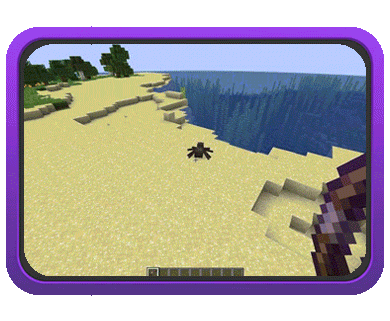
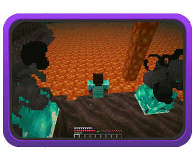
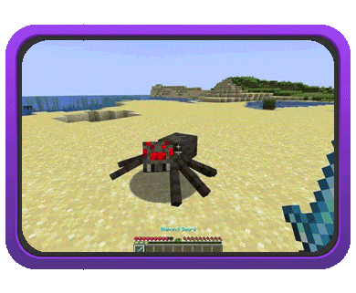
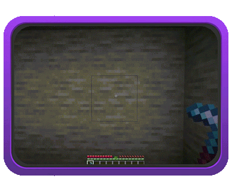
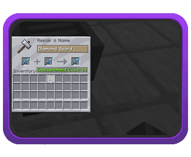
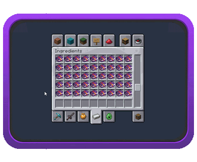
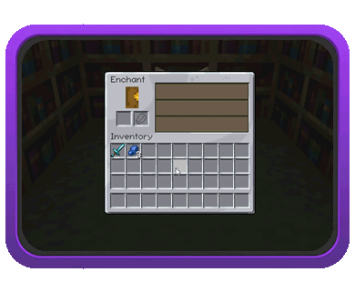
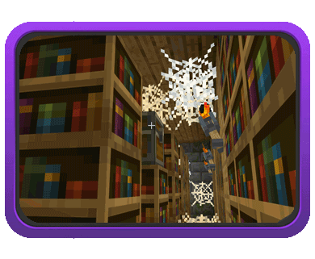

# 关于

**ExcellentEnchants** 是一款轻量的现代化附魔插件，添加了**超过 80 种原版风格的附魔**，可根据服务器完全自定义。

**ExcellentEnchants 不会**修改战利品表，村民交易或附魔台——与原版或数据包附魔一样，都以同一方式无感集成至服务器。

**ExcellentEnchants** 在删除后**不会**对服务器造成**永久性**影响，就像插件从未被安装过——没有报错、漏洞或崩溃，也永远不会有。

[**点此浏览所有附魔！**](enchantments/list.md)

::: image-grid

***

:::

## 特色

### 兼容性

* 无感集成。完全兼容其他原版附魔、命令，以及其他插件。
* **支持铁砧 & 砂轮**。像原版附魔一般合并或祛除附魔。
* **附魔书支持**。直接从创造模式菜单中获取附魔书。
* 支持 **PlaceholderAPI**。

::: image-grid

:::

### 附魔分布

* **附魔台 & 村民交易**。可从游戏的正常流程中获取插件附魔。
* **随机战利品**。可以在地牢等结构的宝箱中寻获本插件的附魔。
* **渔获**。可以通过钓鱼获得携带自定义附魔的附魔书。
* **实体装备**。自然生成的实体可以装备携带自定义附魔的装备。

::: image-grid

:::

### 自定义 & 控制

* **高度自定义**。可以随意修改任何附魔的属性。
* **超限附魔**。允许物品超出其最大附魔等级限制。
* **附魔限制**。自由配置不共存的附魔列表。
* **禁用附魔**。在当前世界或全服禁用某个附魔。

### 物品 & 装备支持

* **斧类兼容**。默认允许剑类附魔兼容斧类工具。
* **弩弓兼容**。默认允许弓类附魔兼容弩类工具。
* **支持鞘翅**。默认允许胸甲类附魔兼容鞘翅。
* **物品列表**。添加或修改适用附魔的初级或次级物品列表。

### 玩家界面 & 展示

* **附魔界面**。打开后可浏览所有自定义附魔。
* **彩色提示**。为自定义附魔设置彩色提示文本。
* **描述提示**。在物品描述中显示附魔的效果。
* **视觉效果**。部分附魔有自定义粒子效果及音效。

### 进阶机制

* **附魔充能**。插件引入了几种需要充能使用的附魔。
* **全新诅咒**。引入原版未曾存在的几种诅咒附魔。

## 安装需求

使用 **ExcellentEnchants** 前**必须**安装 [NightCore](https://nightexpressdev.com/nightcore/)。

支持如下服务器核心与版本。

| 服务器版本 | Paper | Spigot | Folia | Java 版本 |
| --- | --- | --- | --- | --- |
| 1.21.11 | ✔️ | ✔️ | ❌ | 21 |
| 1.21.10 | ✔️ | ✔️ | ❌ | 21 |
| 1.21.9 | ✔️ | ❌ | ❌ | 21 |
| 1.21.8 | ✔️ | ✔️ | ❌ | 21 |

* **不**支持任何不在列表中的版本。
* 可以在这里浏览所有已知兼容性问题及其他常见问题。

**可选插件：**

* [PacketEvents](https://spigotmc.org/resources/80279/) -（任选其一安装）在物品中显示附魔描述。
* [ProcotolLib](https://ci.dmulloy2.net/job/ProtocolLib/) -（任选其一安装）在物品中显示附魔描述。