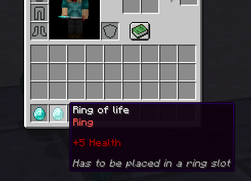
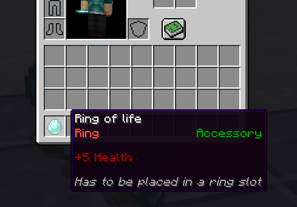

# 🔌 其他插件

MMOInventory 的一大特色就是内置了对其他物品插件的支持。它可以从 LoreAttributesRecoded、Oraxen 或 Nexo 这样的插件中读取属性，但也只能通过固定模板匹配描述里的内容。例如，如果物品描述里有 `&c剑`，那么 MMOInventory 可以检测它，让槽位限制正常生效。

这是一种“伪物品类型”，虽然没有在 MMOItems 这样的插件中经过注册，但仍然可以归入特定分类（通过识别特定格式的描述判断其类型）。

`loretag{tag="&c戒指"}` 之类的条件只会允许描述中完全包含 `&c戒指` 的物品放入。这类槽位限制完全兼容基本的颜色代码。`loretag{tag="&c剑";check="EQUALS"}` 的效果基本相同。如下物品包含一行 `&c戒指`，因此适用槽位限制条件。

`loretag{tag="&c描述";check=CONTAINS}` 检测物品的描述中是否含有 `&c戒指`。如下物品包含一行 `&c戒指`，但也有其他描述，仍然适用槽位限制条件。

`check` 参数还可填入 `STARTS_WITH` 和 `ENDS_WITH` 参数，分别表示检查物品中是否包含以给定内容开头或结尾的描述。