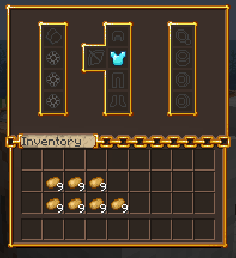

# 🎨 界面纹理

本章将会讲述如何向 MMOInventory 中的自定义玩家界面添加自定义纹理。

## 问题

如下为无贴图的自定义界面示例。如你所见，原版格子相当不美观，我们需要将其遮住。


## 自定义字体

默认情况下，MMOInventory 会利用自定义字体处理界面贴图。在本教程中，我们默认界面配置位于 `MMOInventory/inventory/default_mmoinventory.yml`。

``` YAML
ui_layout:
  # .....
  name:
    self: "&f%mythiclib_space_-17%\u40E0%mythiclib_space_-169%<#3F3F3F>Equipment"
    other: "&f%mythiclib_space_-17%\u40E0%mythiclib_space_-169%<#3F3F3F>Equipment of {name}"
```

注意这里有两个名字，一个是打开自己界面的标题，另一个则是观察其他玩家界面时的标题。另外还需注意：

* `\u40E0` 是 MMOInventory 纹理包默认使用的自定义字符。
* `%mythiclib_space_-17%` 是 MythicLib 使用的变量，会插入一个 -17 单位宽的空白。
* `<#3F3F3F>` 为 Minecraft 默认的界面字体颜色（至 1.21.8）。

MMOInventory 准备了四套开箱即用的界面纹理。你可以自行选择一款！如下表格详细介绍了它们。

|纹理|行数|字符|图例|
|---|---|---|---|
|经典|4|`\u40E0`||
|经典|6|`\u40E1`||
|美化|6|`\u40E2`||
|Oraxen 风格|5|`\u40E3`||

## 低于 1.20 的版本

在 1.20 以下的版本，物品模型有一个 `display.item.scale` 参数可以实现自定义界面。通过使用均匀灰色纹理充当填充物，你可以将其设置为 1.1（110% 纹理大小），可以让物品溢出边框，盖住原版的格子图案。

::: details 旧模型文件

便于参考引用，如下为用于填充纹理的模型文件。需要注意的是，其为均匀的灰色（<selColor display-color="#C6C6C6" />，原版背景色，至 1.21.8）纹理。

``` JSON
{
  "parent": "item/handheld",
  "textures": {
    "layer0": "mmoinventory:item/fill"
  },
  "display":{
    "gui": {
        "rotation": [ 0, 0, 0 ],
        "translation": [ 0, 0, 0 ],
        "scale": [ 1.1, 1.1, 1.1 ]
    }
  }
}
```

:::

在最近的版本（1.21 以上），这种方法已经无法使用。虽然 `scale` 参数仍然存在，但这个特性已被修复。因此，我们建议通过自定义字体完全覆盖原版界面的纹理。好消息是，这种方法非常简单，你也可以借此自定义背包界面的样式。 