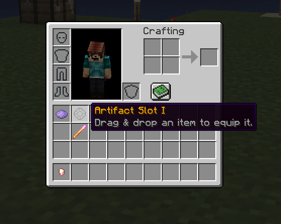

# 🎒 原版界面

玩家的原版界面可以直接显示饰品栏与按钮。这个功能与自定义界面完全兼容，无论其有多少。



## 配置

切换 `enabled` 选项或删除 `vanilla_inventory.yml` 文件都可以禁用对玩家原版界面的修改。默认禁用，因此若不需要使用，无需改动任何配置。

``` YAML
# 对于原版界面，这个选项不太重要
# 只需与其他界面区分开即可。
id: vanilla_inventory

# 在玩家的原版 3x9 界面中放置物品
# 可填“vanilla（原版）”或“custom（自定义）”
type: vanilla

# 是否临时启用或禁用界面。
# 原版界面默认禁用。
enabled: false
```

::: warning

确保你将 `type` 设置为了 `vanilla`。也请确保你只有一个类型为 `vanilla` 的界面配置。

:::

## 物品槽位

在槽位配置部分设置的任何格子都会出现在玩家背包中。与背包界面类似，玩家可以将物品放入自定义格子将其装备。槽位物品会在玩家登录时显示，因此确保编辑槽位配置后重启了服务器。

::: info

需要注意的是，你不能在原版界面中使用部分槽位类型，例如 `helmet`（头盔）和 `off_hand`（副手），因为它们已经存在。

:::

若玩家加入游戏，且原版界面对应位置已有物品，MMOInventory 尝试替换物品时会将其移到别处。此过程中玩家的物品不会丢失。